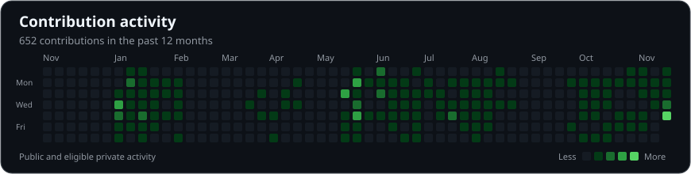

# Aymane Belkhiri

**Full-stack developer · Zaragoza, Spain**

I build web applications for automotive and service businesses, from public websites and product catalogues to back-office tools and multi-role workflows.

[Explore my projects](#selected-projects) · [View my GitHub activity](#js-contribution-activity-description)

## GitHub stats

**652 contributions in the past 12 months** · Updated daily from GitHub.

| Current streak | Longest streak since joining GitHub |
| :--- | :--- |
| **5 days** | **11 days** |

[View the live contribution graph](https://github.com/aymanebelkhiri#js-contribution-activity-description). The total includes eligible private contributions as anonymized counts.

## Top Languages

Language percentages will appear once read-only private repository access is configured.

## Technology stack

          

## Selected projects

### GLASSPHÈRE · Automotive glass marketplace

A platform that brings garages and automotive glass technicians together in France. [Visit the live site](https://glassphere.fr/)

- Worked on processing supplier delivery PDFs and updated the public landing page.
- Automated deployment using GitHub Actions.

**Stack** · PHP, Laravel, Blade, MySQL, JavaScript, GitHub Actions

### Mecatronic Center · Automotive services and catalogue

An automotive service website with a public tyre and service catalogue. [Visit the live site](https://mecatroniccenter.fr/)

- Improved tyre catalogue pagination and how tyre sizes and supplier images are displayed.
- Worked on service pricing and photos, added tests, and automated deployment.

**Stack** · PHP, Laravel, TypeScript, React, Tailwind CSS, Vite

### Briglass Gestion · Garage operations

A back office for glass-repair cases, quotes, invoices, credit notes, and PDF documents.

- Worked on appointment planning and push notifications for the progressive web app.

**Stack** · PHP, Laravel, Blade, JavaScript, Bootstrap, Sass, Vite

### BGG Ambassadors · Referral portal

A portal with separate views for ambassadors and administrators.

- Worked on multi-step referral intake, draft saving, and commission tracking.
- End-to-end integration validation is pending.

**Stack** · PHP, Laravel, TypeScript, Tailwind CSS, Vite

### WINVECIA Trading · Web application

- Contributed to the Laravel application and React frontend for a trading project.

**Stack** · PHP, Laravel, Inertia, React, TypeScript, Tailwind CSS, Vite

### Belkhiri Coding · Website and admin workspace

- Worked on the website’s custom design system and a back office for prospect follow-up, conversations, and invoice documents.

**Stack** · PHP, Laravel, Blade, JavaScript, CSS, Sass

## Additional projects & practice

| Project | My work | Stack |
| --- | --- | --- |
| **Switch Glass** | Worked on service pages, appointment booking, and appointment history. | PHP, Laravel, Blade, JavaScript, Sass |
| **Glass On** | Committed a Laravel application with views, routes, migrations, and a test scaffold. | PHP, Laravel, Vite |
| **Cafétéria de la Gare** | Set up a customer-facing homepage and authenticated routes. | PHP, Laravel, Blade |
| **School Management** | Worked on a school-management app with student and course records and photos. | PHP, Laravel, JavaScript |
| **Personal portfolio** | Built pages for my profile, project work, and contact information. | HTML, CSS |
| **React practice** | Practised component-based development with small apps and a dashboard exercise. | React, JavaScript |
| **E-learning website exercise** | Worked with a frontend template to assemble a homepage and an About page. | HTML, CSS, JavaScript |

The source repositories for these projects are private. The live links above provide access to the public sites.
